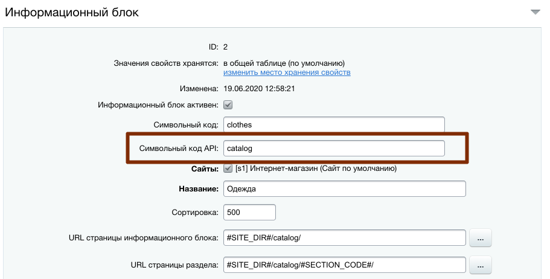

# API bitrix #

Назначение
==========

Установка
=========
### Маршрутизация ###
Для работы системы роутинга необходима версия Bitrix не менее чем `21.400.0`

- Для активации системы роутинга нужно перенаправить обработку 404 ошибок на файл routing_index.php в файле .htaccess:

```
    #RewriteCond %{REQUEST_FILENAME} !/bitrix/urlrewrite.php$
    #RewriteRule ^(.*)$ /bitrix/urlrewrite.php [L]

    RewriteCond %{REQUEST_FILENAME} !/bitrix/routing_index.php$
    RewriteRule ^(.*)$ /bitrix/routing_index.php [L]
```
- Файлы с конфигурацией маршрутов располагаются в папках /bitrix/routes/ и /local/routes/. Для подключения файла следует описать его в файле .settings.php в секции routing:

```
    routing' => ['value' => [
    'config' => ['web.php', 'api.php']
    ]], 

    // подключатся файлы:
    // /bitrix/routes/web.php, /local/routes/web.php,  
    // /bitrix/routes/api.php, /local/routes/api.php
```

- Формат файла предполагает возврат замыкания, в которое передается объект конфигурации маршрутов:

```
    <?php
    
    use Bitrix\Main\Routing\RoutingConfigurator;
    
    return function (RoutingConfigurator $routes) {
        // маршруты
    };
```

Более подобно в [документации](https://dev.1c-bitrix.ru/learning/course/index.php?COURSE_ID=43&LESSON_ID=13766&LESSON_PATH=3913.3516.5062.13764.13766)


### Swagger ###

- Скачать дистрибутив [swagger](https://github.com/swagger-api/swagger-ui), распаковать папку dist внутрь раздела, в
  котором необходимо отображать интерфейс swagger, например /api-docs
- Переименовать index.html в index.php и добавить код автогенерации документации

 ```
    require_once($_SERVER['DOCUMENT_ROOT'] . "/bitrix/modules/main/include/prolog_before.php");

    if (file_exists($autoloadPathDbconn = realpath(__DIR__.'/../local/vendor/autoload.php'))) {
    require_once($autoloadPathDbconn);
    }
    use ApiLib\Swagger\AutoloadAPI;
    AutoloadAPI::generateDoc();
```

В swagger-initializer.js заменить путь к файлу

```
    url: window.location.origin + "/openapi.json",
```

### IBLOCK_ID и PROPERTIES ###

Для доступа к возможностям нового ядра у инфоблока нужно задать `Символьный код API`. 
Это строка от 1 до 50 символов, начинающаяся с буквы и состоящая из латинских букв и цифр.



Для работы с элементами используется класс \Bitrix\Iblock\Elements\ElementXXXXXTable, где XXXXX - Символьный код API. 


